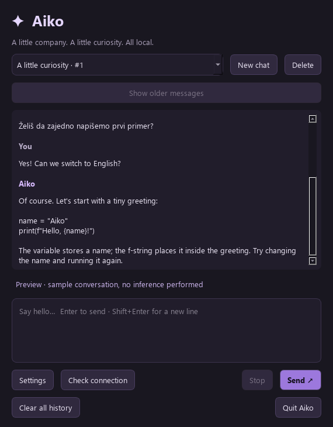

# Aiko

An original, local-first desktop AI companion for Windows 11: a small violet-haired
Qt mascot with a compact chat window powered by your installed Ollama model.
No accounts, API keys, subscriptions, telemetry, or cloud fallback.

**v0.1 is a runnable source MVP.** There is no voice/audio, screen access, file editing,
shell execution, browsing, or autonomous agent infrastructure. Model output is inert text.

## Features

- Transparent, draggable, borderless mascot; click to chat, right-click for menu.
- Idle bounce/tilt/blink, thinking dots, happy expression; reduced motion stops its animation timer.
- Saved position clamped to actual available screens after monitor changes.
- Dark chat with violet accents; Enter sends, Shift+Enter inserts a newline.
- Background inference, Stop, one request at a time, actionable connection errors.
- Default `qwen3:8b`, 4096 context, `think: false`; final answers only.
- SQLite sessions/history with paged browsing and confirmed deletion.
- Editable Aiko character JSON; settings dialog and JSON import/export.
- Loopback HTTP only, no redirects/proxies; remote-model aliases blocked before chat submission.

## Screenshots / widget previews

These are captures of the **actual Qt widgets**, rendered by `scripts/render_preview.py`.
The chat contains labeled sample text, not a claimed model response. These are not desktop
compositor screenshots; native transparency and mixed-DPI appearance still need manual QA.




## Windows 11 setup: PowerShell and VS Code

Install 64-bit Python **3.13** from [python.org](https://www.python.org/downloads/windows/),
VS Code, and [Ollama for Windows](https://ollama.com/download/windows). Enable Python's
launcher/PATH installer options and reopen PowerShell afterward.

Python 3.11–3.14 is allowed by this project's dependency configuration. Python 3.13 is
preferred for a new setup; this implementation was tested with the existing **3.11.5**
environment, so 3.13 itself is not claimed tested. See [PySide6's upstream package](https://pypi.org/project/PySide6/).

In VS Code, use **File → Open Folder**, then **Terminal → New Terminal**. For a fresh clone:

```powershell
git clone https://github.com/MarexMB/Aiko.git
cd Aiko
py -3.13 -m venv .venv
.\.venv\Scripts\python.exe -m pip install -e ".[dev]"
.\.venv\Scripts\python.exe main.py
```

If the project already exists, skip cloning and work in that folder. If `.venv` works,
preserve it. This workspace's existing environment has already been installed and tested;
run immediately with `.\.venv\Scripts\python.exe main.py`.

No activation or execution-policy change is required. If `py` is missing but `python --version`
shows the intended interpreter, use `python -m venv .venv`. If neither exists, install Python
and reopen the terminal. In VS Code, install Microsoft's Python extension and choose
**Python: Select Interpreter → .venv\Scripts\python.exe**.

If your existing PowerShell policy permits activation, you can also run:

```powershell
.\.venv\Scripts\Activate.ps1
python main.py
```

Application dependencies are PySide6 and httpx, plus their transitive packages. Development
adds pytest and Ruff. Installation downloads packages; app use afterward works offline with
an installed local model. Startup never installs dependencies or pulls models.

## Ollama checks

```powershell
ollama --version
ollama list
ollama ps
```

If unavailable, start **Ollama** from the Windows Start menu. Alternatively, start a local-only
server in a separate PowerShell window and keep that terminal open:

```powershell
$env:OLLAMA_NO_CLOUD = '1'
ollama serve
```

If the port is already in use, an Ollama server may already be running. The environment
variable applies to this newly started server, not a running tray app. Server-wide cloud-disable
options are documented in the [official FAQ](https://docs.ollama.com/faq).

**Only if `ollama list` does not contain `qwen3:8b`:**

```powershell
ollama pull qwen3:8b
```

This is an explicit multi-GB download. Do not pull again merely because Aiko cannot connect.
Click Aiko, then **Check connection**. Status represents a point-in-time check, not continuous
monitoring. After a reply, `ollama ps` shows actual GPU residency/context.

On this machine the validation run reported **100% GPU, 4096 context, about 5.6 GB** for
`qwen3:8b`. Model versions, competing apps, and settings affect usage; not every offered
context size will fit 8 GB VRAM. Ollama can keep the model loaded for five minutes after use.
Quitting Aiko does not stop the separate Ollama service.

## Daily use

1. Start Aiko: only the mascot appears. Idle behavior does not request keyboard focus.
2. Click to toggle chat; drag to move; right-click for Open Chat, Settings, Quit.
3. Enter sends, Shift+Enter inserts a newline. Stop cancels the HTTP request.
4. New Chat intentionally starts fresh; earlier chats remain in the dropdown.
5. Show older messages pages backward; Back to latest messages returns from the oldest page.
6. Delete and Clear all history each require confirmation.
7. Closing chat hides it. Use Quit Aiko or the mascot's Quit action to exit completely.

Cancelled/failed requests retain the sent user message, but no partial assistant answer.
Send a follow-up or start a new chat. Cancellation closes the connection; Ollama controls
when its own GPU work/cache are released. Responses appear on completion, not token by token.

## Settings and character profile

Settings validates and saves model, numeric loopback URL, context (2048–16384), always-on-top,
and reduced motion in SQLite's separate `preferences` table. Settings/history changes are
disabled during inference. No personal facts are automatically extracted.

For an editable settings file, copy/edit [settings.example.json](settings.example.json), then
use **Settings → Import settings JSON → Save**. Import takes effect only after Save.
Export settings JSON writes current form values to a chosen file. Aiko does not automatically
read arbitrary JSON at startup. Use `http://127.0.0.1:11434` or `http://[::1]:11434`;
`localhost` is deliberately excluded to avoid DNS. Cloud names and remote aliases are rejected.
v0.1 expects local GGUF model metadata; other model formats are unsupported.

Edit [aiko/characters/aiko.json](aiko/characters/aiko.json) and restart to change personality/art:

| Field | Meaning |
| --- | --- |
| `id` | Stable lowercase ID, currently `aiko`; history is associated with it |
| `display_name`, `description` | Character metadata |
| `system_prompt` | Personality, Serbian/English behavior, honest capability limits |
| `appearance` | `hair`, `accent`, `dress`, `skin`, each a six-digit hex color |
| `animation` | `bounce_px` (0–8), `blink_seconds` (2–12) |

`CharacterManager` exposes only Aiko. Future profiles/renderers can use this boundary without
changing the AI backend. No picker or marketplace exists. Artwork is original and MIT-licensed;
see [resource notes](aiko/resources/README.md).

## Architecture

```text
Character JSON → CharacterManager → Controller → MascotWindow → QPainter renderer
                                       ↕
                                 Chat / Settings UI
                                       ↕ GUI thread only
                                 SQLite database
                                       |
                     copied recent messages + character prompt
                                       ↓
                         conservative context builder
                                       ↓
                         QThread + asyncio HTTP worker
                                       ↓
                         loopback Ollama /api/chat
                                       ↓
                   Qt signals → final answer → UI and SQLite
```

- `aiko/app.py`: lifecycle and orchestration, database owned by the GUI thread.
- `aiko/config.py`: validated preferences and per-user paths; Windows storage logic isolated here.
- `aiko/characters/`: profile schema, loader, one original character.
- `aiko/ai/`: context budget and local HTTP client, independent of Qt widgets.
- `aiko/memory/`: parameterized SQL, sessions/messages/preferences, cascading deletion.
- `aiko/ui/`: views, vector art, placement, settings, worker signals.
- `tests/`: deterministic tests plus opt-in live Ollama integration.

SQLite connections never cross threads. Workers receive copies and immutable settings.
Stop schedules asyncio cancellation; Quit waits for worker completion without forced thread
termination. The small mascot uses an 80 ms timer, disabled with reduced motion. Qt 6 handles
logical coordinates/high DPI; mixed-monitor behavior needs manual verification.

**History is not unlimited model memory.** Up to 40 recent messages are considered and trimmed
using a conservative UTF-8 byte budget, reserving 768 output tokens and 256 template tokens.
This is an estimate, not a model tokenizer. Oversized latest prompts are rejected with guidance.
Display pages are bounded to 20 messages / 100k characters. Replies are limited to 768 tokens /
32k characters; ask to continue a cut-off answer. A larger custom system prompt reduces capacity.

## Local storage and deletion

```text
Windows: %LOCALAPPDATA%\Aiko\aiko.sqlite3    conversations + preferences
         %LOCALAPPDATA%\Aiko\aiko.log        event/error types, rotated (200k × 3)
Linux:   $XDG_DATA_HOME/aiko or ~/.local/share/aiko (not tested)
```

The database is plaintext, protected by OS account permissions, **not encrypted**. Logs omit
prompts, responses, raw server errors, and stack traces. Ollama has its own configuration and
logging policy. No analytics or telemetry code is included in Aiko.

Delete history in the UI to retain preferences. To reset all preferences/history, **Quit Aiko**
first, then open `%LOCALAPPDATA%\Aiko` in File Explorer and delete `aiko.sqlite3`.
Optional exact PowerShell commands:

```powershell
$aikoData = Join-Path $env:LOCALAPPDATA 'Aiko'
Get-ChildItem -LiteralPath $aikoData
# Verify this is Aiko's storage before deleting:
Remove-Item -LiteralPath (Join-Path $aikoData 'aiko.sqlite3') -Confirm
```

Also delete `aiko.log`, `aiko.log.1`, `aiko.log.2` if present to remove logs. SQLite enables
`secure_delete`, but no forensic-erasure guarantee applies to SSDs, backups, or database copies.
Git ignores virtual environments, databases, keys, logs, caches, and models.

## Tests

```powershell
.\.venv\Scripts\python.exe -m pytest -q
.\.venv\Scripts\python.exe -m ruff check .
.\.venv\Scripts\python.exe -m ruff format --check .
.\.venv\Scripts\python.exe -m compileall -q aiko main.py
.\.venv\Scripts\python.exe -m pip check
```

Default tests use temporary databases, fake HTTP responses, and headless Qt; no model/network
required. The live test is skipped unless explicitly enabled:

```powershell
$env:AIKO_TEST_LIVE = '1'
.\.venv\Scripts\python.exe -m pytest -q
Remove-Item Env:AIKO_TEST_LIVE
```

Native Windows Qt tests:

```powershell
$env:QT_QPA_PLATFORM = 'windows'
.\.venv\Scripts\python.exe -m pytest tests/test_gui.py -q
Remove-Item Env:QT_QPA_PLATFORM
```

Generate previews: `.\.venv\Scripts\python.exe scripts/render_preview.py`.
See [manual QA and verification record](docs/QA.md).

## Troubleshooting

| Symptom | Action |
| --- | --- |
| No Python / broken venv | Check outside restricted terminals; otherwise recreate using an installed interpreter. Preserve source/data. |
| Missing PySide6/httpx/aiko | Install with the same `.venv\Scripts\python.exe` used to run Aiko. |
| Ollama unavailable | Start Ollama, verify port/URL, `ollama list`, then Check connection. |
| Model missing | Verify exact tag; pull only if absent. |
| Thinking option rejected | Use current Ollama and `qwen3:8b`; Aiko will not silently enable reasoning. |
| Slow / timeout | Close competing GPU apps; use 4096 context; inspect `ollama ps`. Limits: 90s silence / 180s total, including loading. |
| No final answer | Retry a shorter question. `thinking` and residual think tags are omitted. |
| Mascot disappeared | Restart to clamp saved position. Run one instance at a time. |
| Chat closed but app remains | Use Quit Aiko or right-click mascot → Quit. |
| Invalid preferences | Correct JSON types/ranges. Startup uses safe defaults and explains how to save replacements. |
| Database save/open error | Check permissions and free space. Back up before repair/reset; Aiko does not silently discard history. |

## Status, limitations, and v0.2

Tested on Windows with Python 3.11.5, PySide6 6.12.0, httpx 0.28.1, Ollama 0.40.15 and
`qwen3:8b`. Full tests including real inference passed; native Qt interaction tests passed.
The launched app process responded. The Windows inspection helper was unavailable, so real
desktop transparency, cross-monitor drag, focus, mixed DPI, and idle resource usage still
require manual QA. No numeric idle CPU/GPU claim is made.

This is a vector mascot, not a rigged engine. No Markdown renderer, executable links, encrypted
storage, summarization, retry button, token counter, installer, or single-instance enforcement.
Keep one Aiko process open. Linux and Python 3.13 have not been tested in this environment.

v0.2: complete mixed-DPI/accessibility QA, improve history/context visibility, optional explicit
preference notes, packaging, and richer original art through the renderer boundary. Selectable
profiles can follow later. Voice is a separate future milestone with **no code/dependencies here**.

## Git and publishing

Focused Conventional Commits document development. Nothing is automatically pushed:

```powershell
git status
git log --oneline -n 15
git remote -v
git fetch origin
git log --oneline HEAD..origin/main
# If the remote has new commits, reconcile them before pushing; never force-push.
git push origin main
```

The original [MIT license](LICENSE) is preserved. Dependencies retain their upstream licenses;
review Qt/PySide6 license terms when distributing a packaged app.
References: [Ollama chat](https://docs.ollama.com/api/chat),
[thinking](https://docs.ollama.com/capabilities/thinking), [model info](https://docs.ollama.com/api/show).
